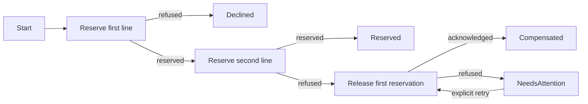

# Two-line reservation saga

WF2 extends this editable host with Sales-owned progress and Inventory-owned reservations.
Each step commits in its module's database. Compensation is a later business operation.



## Run it

Use the connection strings and QueuePrefix from [host setup](README.md). Run `--role setup`
explicitly after updating: additive module migrations and three additional queues are required.
Startup checks storage/topology and never creates them.

Seed two distinct positions (five units at version 2), then start the workers:

```sh
dotnet run --project samples/Wholesale/Worker -- --role seed --StockId 8c6e282e-d9ec-455a-8fab-d114c176a7cd
dotnet run --project samples/Wholesale/Worker -- --role seed --StockId 40e38f42-6f51-416b-bdec-d9e84a5d1575
dotnet run --project samples/Wholesale/Worker -- --role run
```

In another terminal with the same configuration, request two units from the first and six
from the second. The second is refused; compensation releases the first:

```sh
dotnet run --project samples/Wholesale/Worker -- --role reserve-order --OrderId 38418f77-e5b9-4b28-bc83-e46e5a47d8e8 --FirstStockId 8c6e282e-d9ec-455a-8fab-d114c176a7cd --FirstQuantity 2 --SecondStockId 40e38f42-6f51-416b-bdec-d9e84a5d1575 --SecondQuantity 6
dotnet run --project samples/Wholesale/Worker -- --role read-order --OrderId 38418f77-e5b9-4b28-bc83-e46e5a47d8e8
```

Finite commands print JSON with assigned enum numbers (`Compensated = 5`, `Reserved = 3`).
Both quantities within availability reach Reserved and retain both reservations. Seed IDs must
be new. Identical order retries require original lines/versions/quantities. Reads are tenant-scoped.
`FirstVersion`/`SecondVersion` default to 2; quantities default to 1.

Native composition registers `AddStockReservationOrders()` in Sales and
`AddStockReservationInbox()` alongside Inventory stock commands. The host selects
`sales.reservation-outcomes` / `inventory.reservations`, typed dispatchers and existing workers.

```csharp
var orders = scope.ServiceProvider.GetRequiredService<IStockReservationOrders>();
var started = await orders.StartAsync(
    new(orderId, new(firstStockId, firstVersion, 2), new(secondStockId, secondVersion, 6)),
    cancellationToken);
var current = await orders.ReadAsync(started.OrderId, cancellationToken);
```

## Ownership and recovery

[ReservationState](../../modules/Sales/Sales/ReservationOrders/ReservationState.cs) owns requested
lines, stable reservation identities and business status. Ordinary
[ReservationWorkflow methods](../../modules/Sales/Sales/ReservationOrders/ReservationWorkflow.cs)
choose the next reservation, completion, compensating release or operator intervention.
The optional [durable continuation runner](../../../../src/Gloaming.Messaging/docs/workflows.md)
loads the provided process row, matches retained operations/replies, invokes only the saved
method and enqueues its returned request. The [reply handler](../../modules/Sales/Sales/ReservationOrders/StockReservationReplyHandler.cs)
retains producer/tenant/actor admission. Existing inbox processing commits state, next command
and completion together. Direct starts and authorized operator retry retain native save/commit.
The [Inventory handler](../../modules/Inventory/Inventory/Reservations/StockReservationHandler.cs)
reserves against the expected stock version and retains original inputs/decision under
`(OrganizationKey, ReservationId)`. Refused decisions remain final for that identity too.

Release targets reservation identity and uses current stock state, preserving intervening
receipts/issues. Duplicate release changes nothing; duplicate reserve returns its original
decision even after release and cannot resurrect the reservation. Unknown release is refused;
it is not a cancellation tombstone for a future reserve.

Physical OnHand stays unchanged. `Available = OnHand - Reserved` controls issuance and native
EF filtering. Old inline JSON without reserved loads/filters as zero. New reservation event
aliases are explicit; live history reconstructs the same state. Reservation receipts are
business data committed with events, not a separately maintained projection.

Order ID is CorrelationId. Stable command MessageId becomes reply CausationId; subsequent
commands identify the preceding reply as cause. Operator retry uses order identity as cause.
Delivery deduplication, reservation idempotency and semantic reply matching are separate.
Current W3C activity context is retained through existing envelopes when available.

Database/transport failures leave retained work and pending progress. Workers retry in fresh
scopes. Sales compares the original scalar workflow Version and TenantKey; Inventory uses native stream
version predicates and event-position constraints. These arbitrate writers; discard
failed scopes. After an ambiguous commit response, read progress using the original identity.

A refused release leaves NeedsAttention and CompensationRefusal alongside the original
second-line Refusal. After investigation, call `RetryCompensationAsync(orderId)` or
`--role retry-compensation --OrderId ...`. A new delivery targets the same reservation.
Recorded attempt outcomes prevent an old refusal from overwriting a later success. Retry is
accepted only from NeedsAttention; inspect current state after an ambiguous retry commit.
The sample supplies a system actor, but operator authorization/UI and reconciliation policy
remain consumer responsibilities.

Exactly two distinct positions run sequentially. Successful reservations remain held. Shipping,
consuming reservations, expiry, cancellation, parallel lines, scheduling and poison recovery
are deferred. No timeout automatically reverses stock. Deployment owns producer authentication,
queue permissions and DLQ policy; shared demo credentials do not authenticate modules.

Gloaming supplies local processing, durable delivery and an optional typed continuation runner.
The [new report](../../../../docs/reports/wf2-durable-continuations.md) distinguishes fresh protocol
and consumer proofs from the [initial consumer-only run](../../../../docs/reports/wf2-compensating-workflow.md)
and discarded [sequential experiment](../../../../docs/reports/wf2-sequential-saga-coordinator.md).
Ordinary method bindings also support branching, as shown by the standalone workspace adopter.
Parallel pending requests, deadlines and schedulers remain deferred.
